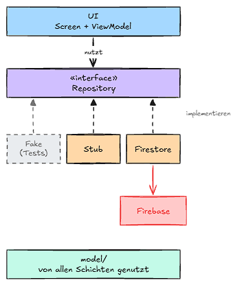

# Entscheidung
Wir folgen Googles empfohlener App-Architektur mit UI- und Datenschicht.
Die UI hängt von der Datenschicht ab, nie umgekehrt. Ein Gradle-Modul `app`.



```
app/src/main/java/com/iu/radio_app/
├── MainActivity.kt
├── model/                Domänenmodell: Track, Show, SongRequest, Rating, User
├── ui/
│   ├── theme/
│   ├── components/       Wiederverwendbare Composables, z. B. Sternbewertung, Titelzeile
│   ├── navigation/       RadioAppRoot, SessionViewModel, Destinations je Rolle
│   ├── login/
│   ├── listener/
│   │   └── <feature>/    Screen, ViewModel, UiState
│   └── moderator/
│       └── <feature>/    Screen, ViewModel, UiState
└── data/
    └── <topic>/          <Topic>Repository (Interface), Stub-/Firestore-Implementierung, ggf. DTOs
```

- `model/` enthält reine Kotlin-Klassen ohne Android, Firebase und Abhängigkeiten auf `data/` oder `ui/`.
  Kleine Fachlogik direkt am Modell ist erlaubt.
- `ui/` trennt zuerst nach Rolle (`listener/`, `moderator/`), darunter nach Feature.
  Jede Rolle hat eigene Tabs, `RadioAppRoot` wählt die Navigation anhand der Rolle.
- Was beide Rollen oder mehrere Features nutzen, liegt in `ui/components/`.
  Diese Composables sind zustandslos, kennen weder ViewModel noch Repository und bekommen Werte und Lambdas.
- `data/` und `model/` sind nach Thema geschnitten und werden von beiden Rollen geteilt.
- Repository-Interfaces liegen in `data/<topic>/`, neben ihren Implementierungen.
- Repositories liefern `Flow` und Modelle aus `model/`, Firebase-Typen und DTOs verlassen `data/` nicht.
- Ein eigener UiState-Typ für Daten entsteht nur, wenn der Bildschirm sie aufbereitet anzeigt.
- Repository und Datenquelle bleiben zusammengelegt, bis es eine zweite Quelle gibt.
- Ein Paket `domain/` mit Use Cases entsteht erst, wenn Logik von mehreren ViewModels geteilt wird.
- Die Regeln prüft ein Konsist-Test (`ArchitekturTest`), nicht nur die Konvention.

# Begründung
Liefert mit einem Interface an der Datengrenze schon Testbarkeit (ViewModel-Tests mit Fake, ohne Emulator)
und eine austauschbare Datenquelle, mit den wenigsten Typen.
Android- und Firebase-Doku sowie Now in Android nutzen genau diesen Aufbau.

# Alternativen
- Ports & Adapters, Interface gehört dem Kern. Im Skeleton fast gleich, aber die Abbildung auf Android müssten wir selbst festlegen.
- Clean Architecture, viele Weiterleitungs-Use-Cases und Mapper ohne Fachlogik, die sie tragen.
- `ui/` nur nach Feature, beide Rollen im selben Paket (z. B. `live/` mit beiden Live-Bildschirmen).
  Lohnt sich nur, wenn sich die Bildschirme ähneln, laut Wireframes tun sie das nicht.
- Eigenes Gradle-Modul `core/designsystem` für `components/` wie in Now in Android. Erst sinnvoll mit mehreren Modulen.
