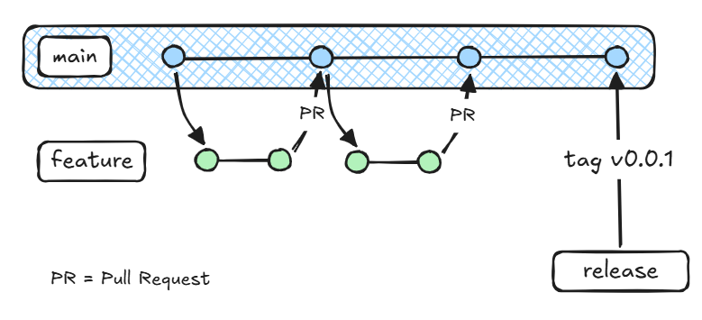

# Entscheidung
GitHub Actions baut und prüft jeden PR. Ein PR darf erst gemergt werden, wenn alle Prüfungen grün sind.
Wir arbeiten in Feature branches, der Main branch ist geschützt. Änderungen werden über einen PullRequest in den Main integriert.
PullRequests können erst nach einem Vier-Augen-Prinzip gemerged werde und wenn alle Tests grün sind.
Ein Git Tag ist der Auslöser für ein Release auf dem Main branch. 
Ein Release baut das APK und läd es auf GitHub hoch.

# Begründung
Fehler sollen vor dem Merge auffallen, nicht danach auf `main`.
Eine gute CI und Testinfra ermöglicht uns eine effiziente asynchrone Teamarbeit.
Ein Release per Tag liefert der Gruppe und den Prüfenden ein installierbares APK ohne Handarbeit.

# Alternativen
- Ohne Regel besteht die Gefahr, dass wir uns den Main-Branch kaputt machen.
- Kurzlebige Branches sollen Merge Konflikte reduzieren.