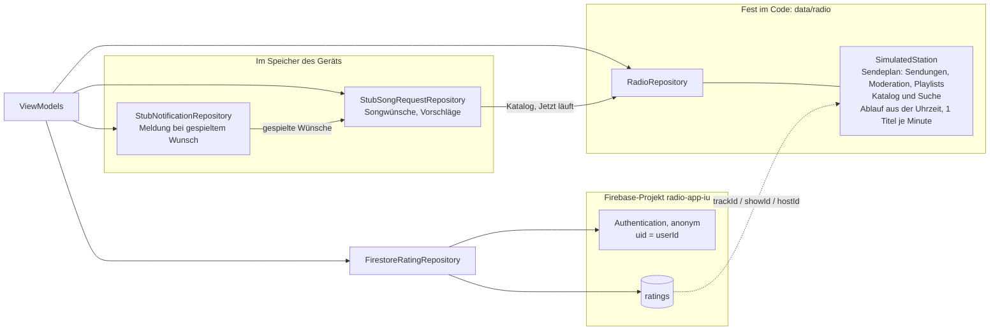

# Entscheidung
Die App ist eine Companion-App zu einem Sender, den es nicht gibt. Wir trennen die Daten des Senders von den Daten der App
(Stand der Umsetzung siehe unten):

- **Senderdaten stehen fest im Code**, im simulierten Sender unter `data/radio`:
  Sendeplan aus Sendungen mit Moderation (`Show`, `Host`) und je einer eigenen Playlist (`Track`),
  dazu Startzeitpunkt und Takt (eine Minute je Titel). Jeder Titel gehört zu genau einer Sendung, der Katalog sind alle Titel zusammen.
  Die App liest sie nur, so wie sie es bei einem echten Sendesystem über dessen Schnittstelle täte.
- **Alles, was vom Sender kommt, liefert `RadioRepository`** in `data/radio`: Programm, „Jetzt läuft“, Playlists und Katalog samt Suche.
  Die Songsuche gehört damit zum Sender, nicht zu den Songwünschen, die nur Daten der App sind.
  Einzige Implementierung ist `SimulatedStation`. ViewModels und andere Repositories kennen nur das Interface.
- **Den Ablauf berechnet der simulierte Sender** aus Senderdaten und Uhrzeit:
  Ab dem Startzeitpunkt spielt jede Sendung ihre Playlist im Takt. Ist sie durch, folgt ohne Lücke die nächste Sendung,
  nach der letzten wieder die erste. Daraus ergeben sich laufende Sendung, „Jetzt läuft“ und die Playlist.
  Nichts davon wird gespeichert, alle Geräte mit demselben Stand berechnen ohne Absprache dasselbe.
- Die Reihenfolge legt allein der Sender fest. Wünsche ändern sie nicht.
- **Firestore enthält nur Daten der App** (ADR 003): `songRequests`, `suggestions` und `ratings`.
  Nur Hörer:innen schreiben, und zwar nur eigene Dokumente. Die Moderation liest nur.
- Beide Seiten sind nur über IDs der Senderdaten verknüpft (`trackId`, `showId`, `hostId`).
  Diese IDs ändern sich nie, neue Einträge sind jederzeit möglich.
  Alle Ausgaben einer Sendung teilen sich eine `showId`, bewertet wird also die Sendung als Ganzes, nicht die einzelne Ausgabe.
  Daten der App mit einer unbekannten ID werden übersprungen statt die App abstürzen zu lassen.
- Ob ein Wunsch gespielt wurde, wird nicht gespeichert, sondern abgeleitet:
  Er gilt als gespielt, wenn sein Titel laut berechneter Playlist nach dem Zeitpunkt des Wunschs lief.
- Gespielte Wünsche werden aus Firestore gelöscht. Das übernimmt die App der Person, die sich den Titel gewünscht hat,
  sobald sie das Spielen bemerkt. Kein Client darf fremde Wünsche löschen.
  Bis dahin filtern alle Ansichten gespielte Wünsche selbst heraus, z. B. die Ansicht der Moderation,
  falls die App der wünschenden Person gerade nicht läuft.

# Umsetzung
Stand heute: Bewertungen liegen in Firestore, Songwünsche und Vorschläge noch im Speicher des Geräts (Stub).

**Simulierter Sender** (`data/radio`)
- `RadioRepository` liefert laufende Sendung, „Jetzt läuft“, Playlists, Sendungen je Moderation, Katalog und Suche.
- `SimulatedStation` ist die einzige Implementierung, in beiden Betriebsarten. Sie läuft im `@ApplicationScope`.
- Startzeitpunkt ist der 1. Januar 2026, 00:00 UTC. Zwei Sendungen mit je fünf Titeln wechseln sich ab.

**Firestore** (Projekt `radio-app-iu`)
- Die App meldet sich beim ersten Zugriff anonym an (`AnonymousUser`). Die `uid` bleibt auf dem Gerät gleich und ist die `userId`.
- `ratings/{userId}_{targetType}_{targetId}`, Aufbau in `RatingDocument`:

  | Feld | Inhalt |
  |---|---|
  | `userId` | `uid` der anonymen Anmeldung |
  | `targetType` | `song`, `show` oder `moderation` |
  | `targetId` | `trackId`, `showId` oder `hostId` aus dem Sender |
  | `stars` | 1 bis 5 |
  | `comment` | Text bis 800 Zeichen oder `null` |
  | `createdAt` | Zeitstempel des Servers |

- Die feste Dokument-ID sorgt dafür, dass eine neue Bewertung die alte derselben Person ersetzt.
- Durchschnitt, Anzahl je Sternzahl und Kommentare rechnet die App selbst aus den Dokumenten eines Ziels. Änderungen kommen live.
- `firestore.rules`: Lesen dürfen alle Angemeldeten. Schreiben und Löschen darf jede Person nur ihr eigenes Dokument.
  Die Regeln prüfen ID, Felder und Wertebereiche. Alles andere ist gesperrt.

**Betriebsarten** (ADR 003)
- Bewertungen kommen standardmäßig aus Firestore, mit `radio.stubs=true` aus `StubRatingRepository`.
- Songwünsche, Vorschläge und Benachrichtigungen kommen in beiden Betriebsarten aus den Stubs.

# Begründung
Die App wird nie veröffentlicht, alle im Team bauen sie aus Git.
Eine Änderung an den Senderdaten ist damit nur ein Commit und erreicht nach dem nächsten Pull alle.
In der App ändert niemand Senderdaten, auch die Moderation nicht. Deshalb müssen sie nicht in einer geteilten Datenbank liegen.
So nutzen wir Firestore nur für Daten, die Geräte untereinander teilen, und brauchen weder Seed-Skript noch Service-Account-Schlüssel.
Der simulierte Sender ist in beiden Betriebsarten (ADR 003) derselbe, nur die Daten der App kommen aus Stubs oder Firestore.
Gäbe es den Sender doch, würde nur `SimulatedStation` durch eine andere Implementierung von `RadioRepository` ersetzt,
die die Schnittstelle des Senders anspricht.
Weil niemand den Ablauf schreibt, brauchen wir weder Cloud Functions, die es nur im kostenpflichtigen Blaze-Tarif gibt,
noch ein Skript, das neben der App laufen muss.
Durch das Löschen bleiben in Firestore nur offene Wünsche, und eine Meldung „Wunsch gespielt“ kommt höchstens einmal.
Der berechnete Ablauf ist in Tests mit fester Uhr vorhersagbar (ADR 006).

# Alternativen
- Senderdaten in Firestore unter `stations/{stationId}`, für Clients nur lesbar.
  Änderungen ohne neuen Build, aber dafür Seed-Skript oder Pflege über die Console, und ohne Veröffentlichung bringt das keinen Vorteil.
- Senderdaten in einer eigenen Firestore-Datenbank im selben Projekt.
  Wie oben, zusätzlich zwei Datenbanken in App, Regeln und Console, und das kostenlose Kontingent gilt nur für die Standard-Datenbank.
- Auch den Ablauf in Firestore speichern (`station/live`, Playlist), geschrieben von
  - einer Cloud Function per Zeitplan: braucht den Blaze-Tarif.
  - einem Simulator-Skript mit Admin SDK: Das Radio läuft nur, solange jemand das Skript startet.
  - der App, eine Transaktion sorgt dafür, dass nur ein Gerät weiterschaltet:
    Läuft nur, solange irgendeine App offen ist, und die Regeln müssten Clients die Senderdaten schreiben lassen.
- Simulator mit eigenem Takt ab App-Start (wie bisher `StubRadio`).
  Einfach, aber jedes Gerät zeigt einen anderen Titel, und ob ein Wunsch gespielt wurde, hinge vom Gerät ab.
- Sendungen zu festen Tageszeiten statt im Wechsel nach jeder Playlist. Realistischer, aber braucht eine Zeitzone
  (`kotlinx-datetime`), und beim Testen sieht man tagsüber nur einen Teil der Sendungen.
- Eine eigene `showId` je Ausgabe. Bewertungen ließen sich einer Ausgabe zuordnen, aber eine Ausgabe dauert nur wenige Minuten,
  sodass jede kaum Bewertungen bekäme.
